<!-- HEADER -->

 

<!--

-->

## 👋 About Me

I'm **Hussain Mansoor**, a **Software Engineering student at SZABIST University, Karachi**. I build complete, working projects: console systems in C, desktop applications in Java and Python, and interactive browser games in JavaScript. I also design digital logic circuits in Multisim.

Before software, I worked as a **Tax Strategist**, handling taxation, accounting, and SECP compliance. That experience gave me a careful, detail-first approach to building reliable systems.

- 🎓 **BSSE** at SZABIST University (2025 to present)
- 🗣️ **Languages:** Urdu (native) and English (professional working proficiency)
- 📂 **Every project** in my repositories includes a README with features and run instructions

## 🛠️ Tech Stack

**Languages**

**Tools & Platforms**

**Frameworks & Libraries**

**Core Concepts**

<table>
  <tr>
    <td align="center" width="33%">🧱 <b>Object-Oriented Programming</b> Classes, inheritance, encapsulation</td>
    <td align="center" width="33%">🌳 <b>Data Structures</b> Organizing data for efficient access</td>
    <td align="center" width="33%">⚙️ <b>Algorithms</b> Game logic and minimax AI</td>
  </tr>
  <tr>
    <td align="center" width="33%">💾 <b>File Handling</b> CSV and text-file storage</td>
    <td align="center" width="33%">🖥️ <b>GUI Development</b> Tkinter, Swing, and JavaFX</td>
    <td align="center" width="33%">🌐 <b>DOM &amp; APIs</b> Vanilla JavaScript and Open-Meteo</td>
  </tr>
</table>

## 🚀 Featured Projects

### 🖥️ Desktop & System Applications

| Project | What it does | Tech |
|---|---|---|
| [**🏦 bank-management-system-c**](https://github.com/Hussain356/bank-management-system-c) | Secure console banking system with hashed passwords, account lockout, transfers, and an admin console | `C` |
| [**☕ cafe-pos-system-python**](https://github.com/Hussain356/cafe-pos-system-python) | Cafe point-of-sale app with tax and service billing, receipts, order history, and sales reports stored in CSV | `Python` `Tkinter` |
| [**⚓ battleship-java-oop**](https://github.com/Hussain356/battleship-java-oop) | Two-player Battleship game with ship placement, save/resume, and a persistent leaderboard | `Java` `Swing` |
| [**📦 inventory-management-system-java**](https://github.com/Hussain356/inventory-management-system-java) | Console inventory app with admin login, product management, and stock-checked purchases | `Java` `OOP` |
| [**🎓 university-management-system-javafx**](https://github.com/Hussain356/university-management-system-javafx) | Manages students, teachers, courses, grades, attendance, and fees, with a dashboard and CSV export | `Java` `JavaFX` `Maven` |

### 🌐 Web Development

| Project | What it does | Tech |
|---|---|---|
| [**🛍️ ecommerce-website-html-css-js**](https://github.com/Hussain356/ecommerce-website-html-css-js) | Responsive fashion storefront with hero slider, mega menu, product grids, and filters | `HTML` `CSS` `JavaScript` |
| [**🌦️ weather-app-javascript**](https://github.com/Hussain356/weather-app-javascript) | Live weather with city search, 5-day forecast, and °C/°F toggle, powered by the Open-Meteo API | `JavaScript` `API` |
| **⌨️ typing-speed-test-javascript** | Real-time typing test measuring WPM and accuracy, with live character highlighting | `JavaScript` |

### 🎮 Browser Games

| Project | What it does | Tech |
|---|---|---|
| [**❌ tic-tac-toe-game-javascript**](https://github.com/Hussain356/tic-tac-toe-game-javascript) | Tic Tac Toe against a friend or a three-level computer opponent (minimax on Hard), with best-of-N matches | `JavaScript` |
| [**🐍 snake-game-javascript**](https://github.com/Hussain356/snake-game-javascript) | Classic Snake with keyboard and on-screen controls and a persistent high score | `JavaScript` |
| [**✂️ rock-paper-scissors-javascript**](https://github.com/Hussain356/rock-paper-scissors-javascript) | Rock Paper Scissors against the computer, with a saved scoreboard and keyboard shortcuts | `JavaScript` |
| [**🃏 memory-card-game-javascript**](https://github.com/Hussain356/memory-card-game-javascript) | Memory matching game with 8 pairs, flip animations, a 60-second timer, and a flip counter | `JavaScript` `CSS` |
| **🔤 word-arena-game-javascript** | Hangman and Word Scramble in one web app, with unit tests and GitHub Pages deployment | `JavaScript` |

### 🎨 Creative & Interactive Tools

| Project | What it does | Tech |
|---|---|---|
| [**🎹 virtual-piano-javascript**](https://github.com/Hussain356/virtual-piano-javascript) | Playable 17-key piano controlled by keyboard or mouse, with volume control and overlapping notes | `JavaScript` `HTML5 Audio` |
| [**🎨 canvas-paint-javascript**](https://github.com/Hussain356/canvas-paint-javascript) | Browser drawing app with brush, shapes, undo/redo, and PNG export | `JavaScript` `Canvas` |

### ⚡ Digital Electronics

| Project | What it does | Tech |
|---|---|---|
| [**⏱️ digital-stopwatch-circuit-multisim**](https://github.com/Hussain356/digital-stopwatch-circuit-multisim) | Digital stopwatch built from 7490 counters, 7447 decoders, and six seven-segment displays | `Multisim` `Digital Logic` |

## 🎯 What I Focus On

- **Object-oriented design:** separating game logic, user interface, and file storage into clear classes
- **Data persistence:** CSV and text-file storage for sales, scores, and saved games
- **Security basics:** salted password hashing and account lockout in C
- **Interactive front-end:** canvas drawing, audio, animations, and game logic in vanilla JavaScript
- **Digital logic:** counters, decoders, and seven-segment displays simulated in Multisim

## 💪 Strengths

| 🧠 Analytical Thinking | 💬 Clear Communication | ⚡ Fast Learner | 🤝 Team Player | 🛡️ Integrity |
|:---:|:---:|:---:|:---:|:---:|
| Breaks problems into logical steps | Strong verbal and written skills | Adapts quickly to new technologies | Experience in client-facing and collaborative roles | Honest, dependable, dedicated |

## 📊 GitHub Stats

<em>Open to internships, collaborations, and learning opportunities.</em>

